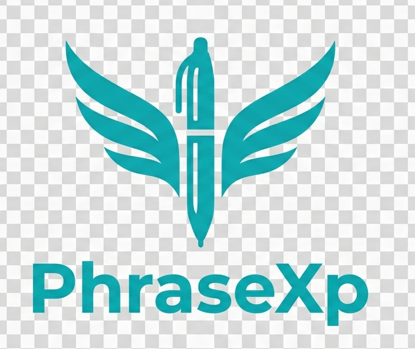

# PhraseXp



**A fast, keyboard-first text expander and productivity tool for developers.**

PhraseXp is a cross-platform text expansion tool built with **Rust, Tauri 2, and Svelte**.

I built it because my preferred text expander, aText Pro, didn't support Linux. After trying several alternatives, I decided to build a tool that combines the features I wanted from **aText, PhraseExpress, and Espanso**, along with developer-focused workflows such as macros, spellcheck, clipboard history, and AI-assisted editing.

## ✨ Features

- ⚡ **Silent autotext** — expand shortcuts automatically as you type

- ⌨️ **Global hotkey popup** — search and insert phrases from anywhere

- 🧩 **Rich macros** — dates, date math, UUIDs, random IDs, calculations, clipboard content, regex, and more

- ✍️ **As-you-type spellcheck** — with per-application exclusions

- 🤖 **AI integration** — use your own OpenAI, Groq, or DeepSeek API key

- 📋 **Clipboard history** — quickly retrieve previous clipboard entries

- 🔐 **Optional encryption** — protect stored data with at-rest encryption

- 🖥️ **Cross-platform** — Linux (primary), Windows, and macOS

- 🔧 **Developer-focused** — snippets, commands, templates, regex, boilerplate, and more

### Platform support

| Capability | Linux | Windows | macOS |
| --- | --- | --- | --- |
| Autotext + spellcheck | ✅ X11; ✅ Wayland via `ydotool` | ✅ | ✅ (needs Accessibility + Input Monitoring grants) |
| Hotkey popup / chooser | ✅ | ✅ | ✅ (popup takes app focus) |
| App-scoped phrases, app exclusions | ✅ | ✅ | ⏳ frontmost-app detection pending (scopes fire globally) |
| Clipboard history | ✅ (native Wayland) | ✅ | ✅ |
| Markdown rich paste | ✅ | plain-text fallback | ✅ |
| At-rest encryption key store | Secret Service | Credential Manager | Keychain |

Known limits (all platforms): the keystroke decoder assumes a **US keyboard
layout**; Secure Input on macOS (password fields) pauses global listening;
elevated Windows windows (admin shells) don't receive synthetic input; and
PhraseXp can't ship in the Mac App Store — the sandbox forbids global event
taps. See `RELEASING.md` for distribution notes.

---

## 🚀 Examples

### Text Expansion

```text
/sig       → Your complete email signature
/ty        → Thank-you response
/followup  → Follow-up email template
```

### Developer Macros

```text
/date      → 15 September 2026
/uuid      → 550e8400-e29b-41d4-a716-446655440000
/calc      → Evaluate an expression
```

Macros can generate dynamic content rather than simply inserting static text.

### AI Editing

Transform text directly within your workflow:

```text
Rewrite professionally
Fix grammar
Summarize
Translate
Make concise
Generate a response
```

Use your own API credentials with supported providers.

---

## 🛠️ Tech Stack

| Layer            | Technology           |
| ---------------- | -------------------- |
| Desktop          | Tauri 2              |
| Backend          | Rust                 |
| Frontend         | Svelte + Vite        |
| Database         | SQLite / `rusqlite`  |
| Keyboard/Input   | `enigo`, `rdev`      |
| Clipboard        | `arboard`            |
| HTTP             | `reqwest`            |
| Markdown         | `pulldown-cmark`     |
| Expressions      | `meval`              |
| Pattern matching | `regex`              |
| Dates & IDs      | `chrono`, `uuid`     |
| Encryption       | `aes-gcm`, `keyring` |

---

## 💻 Installation

### Prerequisites

Install the required **Rust, Node.js, and Tauri 2** tooling for your platform.

On Linux, PhraseXp currently requires:

```text
webkit2gtk-4.1
libxtst
```

For Wayland environments:

```text
ydotool
```

Windows and macOS need no extra runtime packages; the installer covers them.
macOS additionally requires **Accessibility** and **Input Monitoring** grants
(System Settings → Privacy & Security) — without them macOS silently ignores
the listener; the app surfaces this state in its header.

### Build from Source

```bash
git clone https://github.com/emeeran/phrasexp.git
cd phrasexp

npm install
npm run tauri dev
```

For a production build:

```bash
npm run tauri build
```

> See the repository documentation for platform-specific dependencies and build instructions.

---

## 🏗️ Architecture

```text
Svelte UI
   │
   │ Tauri IPC
   ▼
Rust Core
   ├── Text Expansion
   ├── Hotkeys
   ├── Macros
   ├── Spellcheck
   ├── Clipboard
   ├── AI Integration
   └── Encryption
        │
        ▼
   SQLite / Keyring
```

The Rust core handles operating-system integration and performance-sensitive functionality, while Tauri and Svelte provide the desktop UI.

---

## 🔒 Privacy & Security

PhraseXp is designed around local-first usage.

- Phrase data is stored locally.

- AI requests use the provider and API key you configure.

- Optional encryption is available for stored data.

- API credentials can be stored using the system keyring.

Review the implementation and documentation for the exact security model before using PhraseXp for sensitive information.

---

## 🗺️ Roadmap

- [ ]  Improved phrase management

- [ ]  Advanced macro system

- [ ]  Import/export

- [ ]  Phrase synchronization

- [ ]  Expanded AI workflows

- [ ]  Improved Wayland support

- [ ]  Additional customization

- [ ]  Automated testing

- [ ]  Improved documentation

---

## 🤝 Contributing

Contributions are welcome.

If you find a bug, have a feature request, or want to improve PhraseXp:

1. Open an issue describing the problem or proposal.

2. Fork the repository.

3. Create a feature branch.

4. Make your changes and add tests where appropriate.

5. Submit a pull request.

Please check existing issues before opening a new one.

---

## ⭐ Support the Project

If PhraseXp is useful to you, consider **starring the repository** and sharing feedback.

⭐ [Star PhraseXp on GitHub](https://github.com/emeeran/phrasexp.git)

---

## 📄 License

See the repository for the current license and licensing terms.
