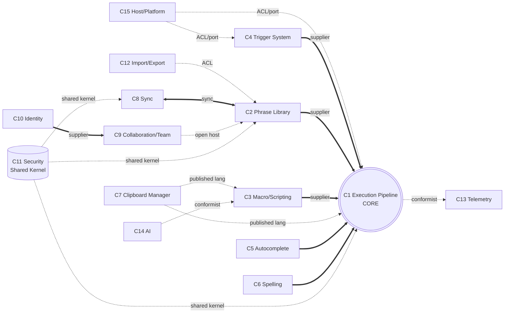

# CONTEXT_MAP.md — phrasexp

> **SDD Stage:** P0 — Domain Modeling (conceptual)
> **Companion to:** `DOMAIN.md`
> **Purpose:** Define **bounded contexts** and their **integration relationships** so each can be
> specified, built, and evolved independently. Strictly conceptual — no technology choices.

---

## 1. Bounded Contexts

| # | Context | Type | Owns | Notes |
|---|---|---|---|---|
| C1 | **Execution Pipeline** | **Core** | The expansion runtime: trigger → resolve → expand → deliver | Orchestrator; depends on most others only at expansion time |
| C2 | **Phrase Library** | Supporting | Phrases, Folders, versions, links, metadata | Authoring surface ("editor") |
| C3 | **Macro / Scripting Engine** | Supporting | Dynamic content, input forms, conditionals, loops, actions | Upstream supplier to C1 |
| C4 | **Trigger System** | Supporting | Input detection + matching (autotext, hotkey, window, clipboard, time) | Lowest-level host coupling |
| C5 | **Autocomplete / Prediction** | Supporting | Inline suggestions, usage learning | Adaptive model |
| C6 | **Spelling Correction** | Supporting | Typo learning + dictionaries | Distinct from autotext |
| C7 | **Clipboard Manager** | Supporting | Clipboard history, context hints, formatting | Publishes entries for reuse |
| C8 | **Synchronization** | Generic | Cross-device library consistency + conflict merge | Offline-first queue |
| C9 | **Collaboration / Team** | Generic | Shared libraries, client-server, central admin | Depends on C10 |
| C10 | **Identity & Access** | Generic | Users, roles, permissions, SSO | Only when C9 is in scope |
| C11 | **Security** | Generic | Encryption, digital signature, sensitive-data masking, UI restrictions | Shared kernel |
| C12 | **Import / Export** | Generic | External-format conversion (DOC/CSV/XLS/Outlook/…) | Anti-corruption layer |
| C13 | **Telemetry / Statistics** | Generic | Usage tracking, frequency metrics | Conforms to C1's events |
| C14 | **AI Integration** | Generic | Translation/rewrite/generation, desktop AI surface | External gateway; optional |
| C15 | **Host / Platform Integration** | Generic | OS hotkeys, input injection, window detection, per-app context, portable mode | Port behind an interface |

---

## 2. Integration Patterns (DDD)

How contexts talk, and who depends on whom.

| Upstream (→) | Downstream | Pattern | Meaning |
|---|---|---|---|
| **C2 Phrase Library** | **C1 Execution** | **Customer–Supplier** | Execution consumes the phrase model Library publishes; Library evolves its schema with Execution's needs in mind |
| **C3 Macro/Scripting** | **C1 Execution** | **Customer–Supplier** | Execution calls the scripting engine to evaluate dynamic content at expansion |
| **C4 Trigger System** | **C1 Execution** | **Customer–Supplier** | Trigger emits `TriggerFired`; Execution is the only consumer that acts |
| **C7 Clipboard Manager** | **C1 Execution**, **C3 Scripting** | **Published Language** | Clipboard entries are a well-defined read model many can consume |
| **C1 Execution** | **C13 Telemetry** | **Conformist** | Telemetry conforms to Execution's event schema; no negotiation |
| **C14 AI** | **C3 Scripting** | **Conformist** | AI presents itself as just another macro source to the scripting engine |
| **C12 Import/Export** | **C2 Phrase Library** | **Anti-Corruption Layer (ACL)** | External formats are translated at the boundary; Library never sees raw DOC/CSV shapes |
| **C15 Host/Platform** | **C4 Trigger**, **C1 Execution** | **Anti-Corruption Layer / Port** | OS specifics isolated behind a host port so the domain stays platform-neutral |
| **C11 Security** | *(all)* | **Shared Kernel** | Encryption keys, masking rules, audit contracts shared across contexts |
| **C8 Sync** ↔ **C2 Library** | | **Customer–Supplier + Published Language** | Sync reads/writes Library via its published model; conflict merge is Sync-owned |
| **C9 Collaboration** | **C2 Library**, **C10 Identity** | **Open Host Service** | Collaboration exposes a service (shared libraries, multi-user) that others consume by contract |
| **C10 Identity** | **C9 Collaboration** | **Customer–Supplier** | Collaboration consumes Identity's user/role model |
| **C5 Autocomplete** / **C6 Spelling** | **C1 Execution** | **Customer–Supplier** | Each injects inline behavior into the typing stream Execution controls |

### Conformance boundaries
- **Ubiquitous Language is shared across all contexts** (the glossary in `DOMAIN.md` is the lingua franca). Each context may refine terms internally but must not contradict them.
- **Security (C11)** is the only true *shared kernel* — its encryption/masking/audit contracts are agreed jointly and changed carefully.

---

## 3. Context Map (diagram)

*Legend:* `==>` Customer–Supplier · `-.->` ACL / Published Language / Conformist / Open Host · `<==>` two-way sync.

---

## 4. Context Responsibilities & Contracts (summary)

- **C1 Execution** owns the *expansion transaction* and is the only context allowed to **deliver** output. It owns no phrase data.
- **C2 Phrase Library** owns phrase/folder **lifecycle and persistence**; it never injects keystrokes.
- **C3 Scripting** owns *evaluation*; it is pure (input → value/action) and owns no persistence.
- **C4 Trigger** owns *detection & matching*; it emits events, it does not expand.
- **C7 Clipboard** is a *read model publisher*; producers push captures, consumers pull entries.
- **C8 Sync / C9 Collaboration** own *distribution*; they never redefine what a Phrase is.
- **C11 Security** is consulted, not bypassed — every context routes sensitive data through its contracts.
- **C15 Host/Platform** is the only context permitted to touch OS input APIs; all others depend on its port.

---

## 5. Build Sequencing (conceptual)

Contexts should come online in dependency order; downstream Requirements will finalize this:

1. **C15 Host/Platform** + **C4 Trigger** (can't expand without detection)
2. **C2 Phrase Library** + **C1 Execution** (the core expansion loop)
3. **C3 Scripting** (unlocks dynamic content) + **C7 Clipboard**
4. **C6 Spelling**, **C5 Autocomplete**, **C12 Import/Export**, **C11 Security**
5. *(Deferred)* **C8 Sync**, **C9 Collaboration**, **C10 Identity**, **C13 Telemetry**, **C14 AI**

> See `DOMAIN.md` §9 for the ⚠️ business-logic gaps that decide how much of this map is built.
